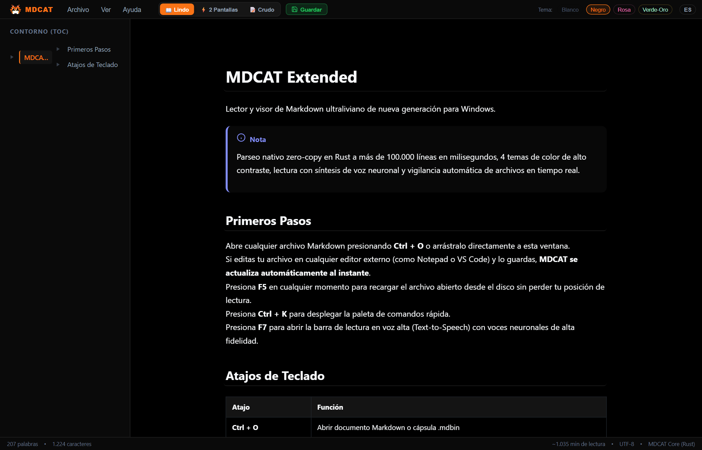
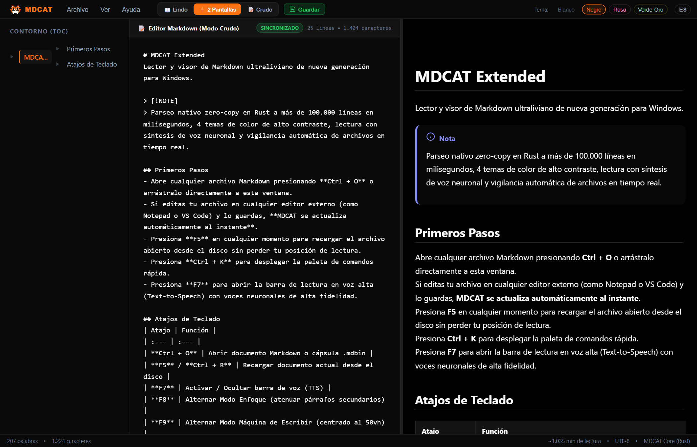
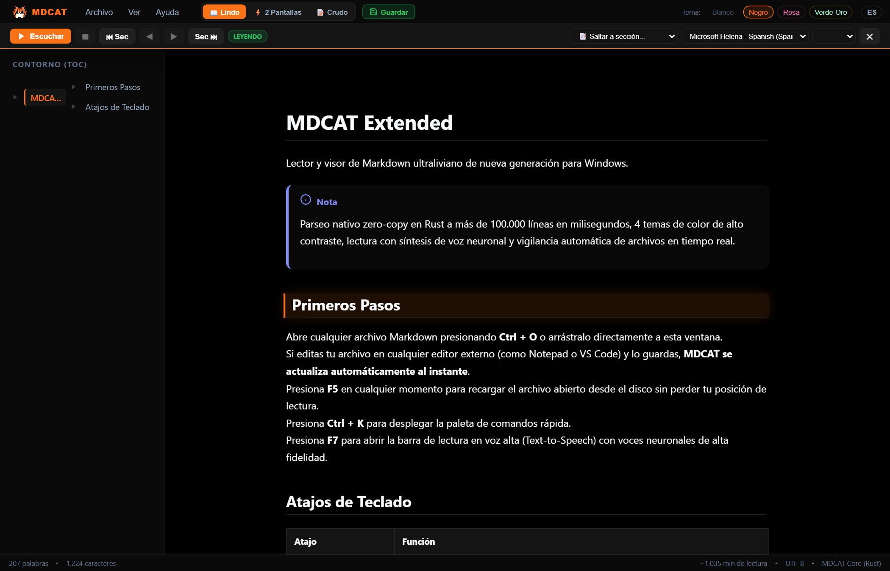
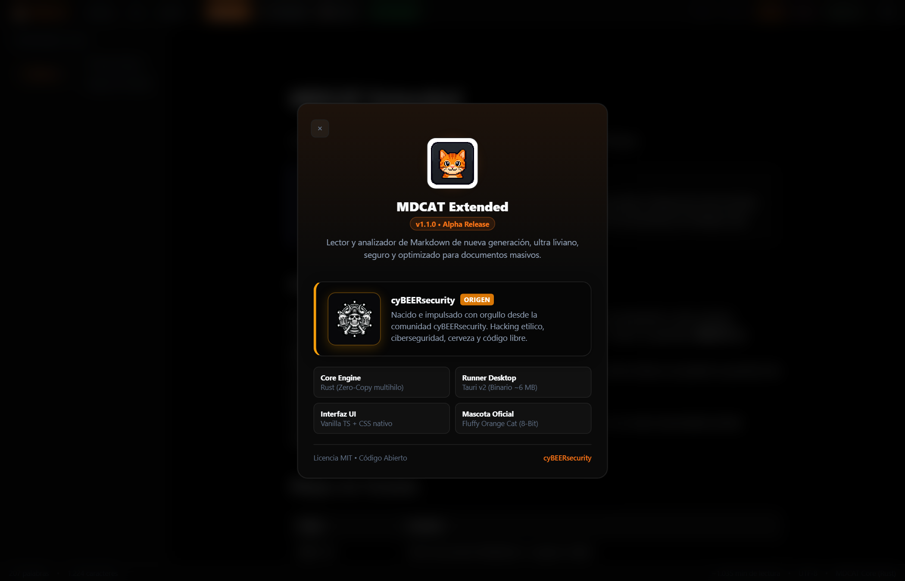
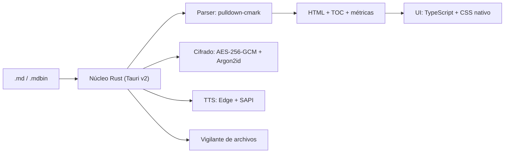

<div align="center">


# MDCAT Extended

**Lector y editor de Markdown de escritorio, ligero y portable.**
Núcleo en Rust · Interfaz en TypeScript sin frameworks · Binario único de ~5 MB

[](https://www.rust-lang.org/)
[](https://v2.tauri.app/)
[](https://www.typescriptlang.org/)
[](./LICENSE)


[Capturas](#capturas) · [Funciones](#funciones) · [Atajos](#atajos-de-teclado) · [Compilar](#compilación) · [Arquitectura](#arquitectura)

<br />



</div>

## ¿Qué es?

MDCAT Extended es una aplicación de escritorio para **leer, revisar y editar documentos Markdown**, desde notas cortas hasta manuales de más de 100.000 líneas. El parseo lo hace Rust (`pulldown-cmark`) vía Tauri v2 y la interfaz es TypeScript directo sobre el DOM, sin React, Vue ni Angular. El resultado es un `.exe` portable de ~5 MB que arranca al instante.

## Capturas

<table>
  <tr>
    <td width="50%">
      
      <p align="center"><b>2 Pantallas</b>: editor y vista previa sincronizados</p>
    </td>
    <td width="50%">
      
      <p align="center"><b>Lectura en voz alta</b>: resalta el bloque que se está leyendo</p>
    </td>
  </tr>
  <tr>
    <td width="50%">
      
      <p align="center"><b>Lindo</b>: lectura con índice lateral y callouts</p>
    </td>
    <td width="50%">
      
      <p align="center"><b>Acerca de</b></p>
    </td>
  </tr>
</table>

## Funciones

### Tres modos de vista

| Modo | Para qué |
| :--- | :--- |
| **Lindo** | Lectura a pantalla completa: tipografía cuidada, tablas, bloques de código y callouts estilo GitHub (`> [!NOTE]`, `> [!TIP]`…). |
| **2 Pantallas** | Markdown crudo a la izquierda y vista previa en vivo a la derecha. El divisor se arrastra y vuelve a 50/50 con doble clic. |
| **Crudo** | Solo el editor, con indentación por `Tab`, contador de líneas/caracteres y estado *Sincronizado* / *Modificado*. |

`Ctrl + E` alterna entre los tres.

### Lectura y edición

- **Recarga automática**: si guardas el archivo desde otro editor (VS Code, Notepad…), MDCAT lo recarga sin perder la posición del scroll. `F5` fuerza la recarga.
- **Guardado** con `Ctrl + S` sobre el archivo original, o diálogo nativo si el documento es nuevo.
- **Índice lateral (TOC)** navegable, generado a partir de los encabezados.
- **Paleta de comandos** (`Ctrl + K`) con búsqueda difusa.
- **Ayudas de lectura**: modo enfoque (`F8`), máquina de escribir (`F9`) y lectura biónica (`F10`).
- **4 temas**: Blanco, Negro (OLED), Rosa y Verde-Oro.
- **Interfaz bilingüe** ES / EN, cambiable en caliente.

### Lectura en voz alta (TTS)

- Voces neuronales de Edge o voces locales de Windows (sin conexión).
- Diccionario de pronunciación para siglas y términos técnicos (`grep`, `docker`, *EDR*, *MITRE ATT&CK*…).
- Resalta en pantalla el bloque que se está leyendo.
- Saltos por sección desde el TOC, el selector *Saltar a sección…* o con `Alt + ↑` / `Alt + ↓`.

### Documentos cifrados `.mdbin`

- Cifrado **AES-256-GCM** con clave derivada mediante **Argon2id**.
- El contenido descifrado vive solo en memoria y se borra (`zeroize`) al cerrar.
- Cualquier `.md` se puede exportar a `.mdbin` desde la paleta de comandos.

## Atajos de teclado

| Atajo | Acción |
| :--- | :--- |
| `Ctrl + O` | Abrir `.md` o `.mdbin` |
| `Ctrl + S` | Guardar |
| `Ctrl + E` | Cambiar modo de vista (Lindo → 2 Pantallas → Crudo) |
| `Ctrl + Shift + L` | Mostrar / ocultar índice lateral |
| `Ctrl + K` | Paleta de comandos |
| `Ctrl + P` | Imprimir / exportar a PDF |
| `F5` · `Ctrl + R` | Recargar desde disco |
| `F7` | Barra de voz (TTS) |
| `F8` | Modo enfoque |
| `F9` | Modo máquina de escribir |
| `F10` | Lectura biónica |
| `Alt + ↑` · `Alt + ↓` | Sección anterior / siguiente en TTS |
| `Esc` | Cerrar ventanas y menús |

## Compilación

### Requisitos

- **Rust** 1.75+ ([rustup.rs](https://rustup.rs/))
- **Node.js** 18+ y npm
- **Windows**: Microsoft Visual C++ Build Tools
- **Linux (Debian/Ubuntu)**: WebKitGTK y dependencias. `./scripts/build-linux.sh --deps` las instala, o a mano:

  ```bash
  sudo apt install libwebkit2gtk-4.1-dev libgtk-3-dev libayatana-appindicator3-dev \
    librsvg2-dev libssl-dev libxdo-dev patchelf build-essential
  ```

### Comandos

```bash
git clone https://github.com/athomo001/mdcad.git
cd mdcad
npm install
```

| Comando | Qué hace | Salida |
| :--- | :--- | :--- |
| `npm run tauri dev` | Desarrollo con recarga en caliente | ventana de la app |
| `npm run build:exe` | `.exe` portable rápido (perfil `release`, LTO *thin*) | `target\release\mdcat-tauri.exe` |
| `npm run build:dist` | Binario final más pequeño (perfil `dist`) + instaladores MSI/NSIS | `target\dist\` |
| `npm run build:msi` | Sube la versión (`-Minor`, `-Major`, `-SetVersion X.Y.Z`), compila `dist` y copia todo a `binarios\` | `binarios\` |
| `npm run build:linux` | En Linux: binario + `.deb`, `.rpm` y `.AppImage` (`-- --fast` usa `release`) | `binarios/` |

GitHub Actions (`.github/workflows/build.yml`) genera los builds de Windows y Linux al publicar un tag `v*` o al lanzarlo a mano.

### Instaladores y asociación de archivos

- **Windows**: MSI (WiX) y `-setup.exe` (NSIS) en español, con la licencia de `src-tauri/installer/licencia.txt`.
- Se registran `.md`, `.markdown`, `.mdown`, `.mkd` y `.mdbin` (en Linux, vía `MimeType` del `.desktop`).
- En Windows 10/11, si ya había otra app predeterminada para `.md`, cámbiala a mano: clic derecho → *Abrir con* → *Elegir otra aplicación* → MDCAT Extended → *Usar siempre*.

Si cambias el logo o la licencia, regenera los recursos del instalador y los iconos:

```powershell
pwsh scripts/generar-recursos-instalador.ps1
npx tauri icon assets/logo.png
```

### Regenerar las capturas

```bash
npm run build
npx vite preview          # en una terminal
npm run screenshots       # en otra (requiere Microsoft Edge)
```

## Arquitectura



- **Sin frameworks SPA**: la interfaz manipula el DOM directamente; el bundle del frontend pesa menos de 80 KB.
- **Workspace mínimo**: `crates/mdcat-core` (parser) y `src-tauri` (aplicación).
- **Compilación rápida**: el perfil `release` usa LTO *thin* para iterar; `dist` reserva `opt-level = "z"` + LTO completo para el binario distribuido. El enlazador es `rust-lld` (`.cargo/config.toml`).


## Licencia

[MIT](./LICENSE) © 2026 cyBEERsecurity y colaboradores de MDCAT Extended.
